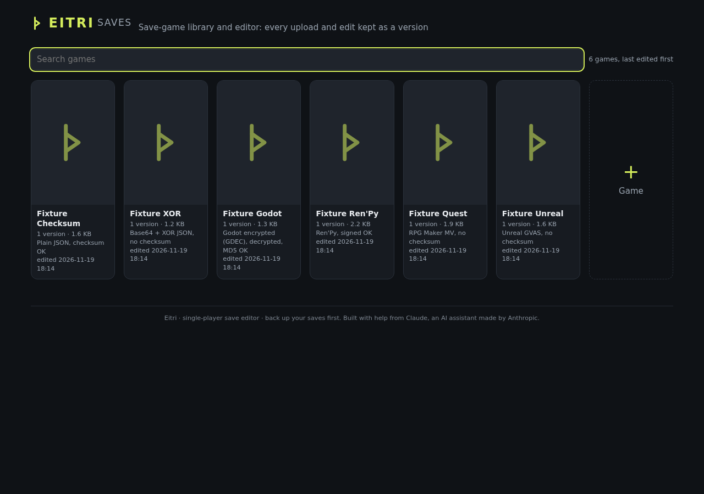
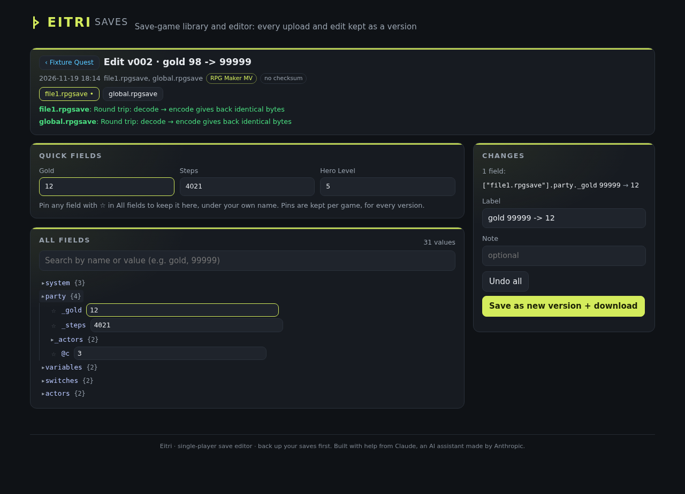

# Eitri

**A self-hosted save library and editor for single-player PC games.**

Upload a save, change a value, download the edited file. Eitri keeps every upload and every edit as a version,
shows what changed between any two versions, and checks each file before you download it.





## Why another save editor

- **Your saves stay on your machine.** Decoding and encoding run in your browser, and files are stored in a
  folder you choose. Online save editors upload your save to their server.
- **History and diffs.** Every upload and every edit is a version with its parent, so you can always go back.
  Comparing two versions is also the quickest way to find what a game calls a field: play a bit, upload again,
  compare.
- **Checks before every download.** Decode then encode must give back the original bytes exactly, and an edit may
  only change the fields you edited plus the ones a game rule links to them.
- **Game rules.** Some games store a value twice or protect it with a checksum. A rule keeps those in step (for
  example the Vampire Survivors SHA-256 checksum, or Long Live The Queen's paired skill values).
- **Pins.** Pin any field to the Quick fields panel under your own name. Pins are kept per game and work on every
  version. A pin on a list item follows the item by name, not by its position.

Eitri is for **single-player games only**. Don't use it on games with online play, leaderboards or anti-cheat.
Always keep a backup of your save; Eitri keeps the original, but copy it somewhere else too.

## Formats

| Plugin | Format | Example games |
|---|---|---|
| `json` | Plain JSON, JSON sequences, OdinSerializer JSON | Brotato, Slay the Spire 2, Inscryption, Monster Train |
| `json-xor` | base64 of XOR-ed JSON | Slay the Spire `.autosave` |
| `rpgmaker-mv` | LZString base64 JsonEx (`.rpgsave`) | RPG Maker MV games |
| `rpgmaker-mz` | zlib JSON (`.rmmzsave`) | RPG Maker MZ games (untested) |
| `renpy` | zip + pickle + ECDSA signature, `persistent` | Ren'Py 7/8 games |
| `gvas` | Unreal Engine GVAS (UE4 and UE 5.4 tags) | Clair Obscur: Expedition 33, Lies of P |
| `godot-encrypted` | Godot `GDEC` (Godot 3 ECB, Godot 4 CFB) | Dome Keeper |

Every format except RPG Maker MZ was checked byte for byte against real saves, and an edited save was loaded in
each of those games.
[PLUGINS.md](PLUGINS.md) has the details and the plugin interface.

**Key files.** Two formats need a key from the game to write a save back. Ren'Py needs `security_keys.txt`
(from `%APPDATA%\RenPy\tokens`) to re-sign an edited save; without it the game asks whether to trust the save.
Encrypted Godot saves need the game's encryption password, as a text file named `*password*.txt`. Keys are
stored in the game's folder and are never sent anywhere.

## Run it

Needs Python 3.10+ and a current browser. No other dependencies, no build step.

```sh
git clone https://github.com/Morgloth/eitri.git
cd eitri
python3 eitri.py                 # http://127.0.0.1:8640/, saves in ./saves
python3 eitri.py --saves-dir ~/GameSaves --port 9000 --offline
```

| Option | Env | Default | |
|---|---|---|---|
| `--saves-dir` | `EITRI_SAVES_DIR` | `./saves` | Where games and versions are stored, as plain folders. |
| `--host` | `EITRI_HOST` | `127.0.0.1` | There is no login. Only listen on other addresses on a network you trust. |
| `--port` | `EITRI_PORT` | `8640` | |
| `--offline` | `EITRI_OFFLINE=1` | off | Never contact Steam or PCGamingWiki. |

**Outside requests.** When you search for a game, Eitri asks the Steam store for matches and a cover image, and
asks PCGamingWiki where the game keeps its saves and whether it uses Steam Cloud. Answers are cached in
`<saves>/.cache/`. Nothing else leaves your machine, and `--offline` turns these lookups off.

**Steam Cloud.** If a game syncs saves through Steam Cloud, turn it off for that game before copying an edited
save in, or Steam may put the old one back. Eitri warns you when PCGamingWiki says the game uses it.

## How it works

```
browser                                         eitri.py + saves.py (Python standard library)
  static/lib/plugins  detect, decode, encode    stores files byte for byte, game.json, meta.json
  static/lib/games    per-game rules            Steam / PCGamingWiki lookups (cached, optional)
  static/app.js       tree, search, diff, pins  no save parsing on the server at all
```

The server never parses a save. The page picks a plugin, decodes the file into a generic tree, and every edit goes
through the plugin and the game's rules. Before the download, the page encodes the file, decodes it again and
compares the trees. The library is plain folders (`<game>/v001-original/…`), so you can browse it in a file
manager. [API.md](API.md) describes the HTTP API.

## Add a game or a format

New formats and game rules are welcome as pull requests. Please include a test: either an entry in
`test/make-fixtures.js` and `test/fixtures.json` (preferred: a small made-up save in the same format), or a
description of the real save you tested with. Requests without code may sit for a while; this is a hobby project.

- A **plugin** reads one file format: `detect`, `decode`, `encode`, `quickFields`.
- A **rule** belongs to one game: `match` the save, then keep `linked` fields in step after an edit.

See [PLUGINS.md](PLUGINS.md) for the interface. Never commit real saves or key files.

## Tests

```sh
node test/run.js                   # plugin round trips on made-up saves (Node 20+)
python3 test/server-check.py       # every API endpoint against a scratch server
pip install playwright && python -m playwright install chromium
python3 test/browser-check.py      # the same round trips inside Chromium
python3 test/page-check.py         # the whole page: create, upload, edit, export, diff, pins, XSS, idle CPU
```

`test/make-fixtures.js` builds a small made-up save in every format, so the tests and CI never need files from
real games. To run the round trips against your own saves: `node test/run.js --samples DIR` (layout and manifest in
`test/samples.json`).

## Credits

Built with help from Claude, an AI assistant made by Anthropic. I directed the design and reviewed and tested the
code. lz-string 1.5.0 by Pieroxy (MIT). Steam and PCGamingWiki data belong to their owners. Eitri is not
affiliated with any game or publisher.

## Licence

MIT, see [LICENSE](LICENSE).
